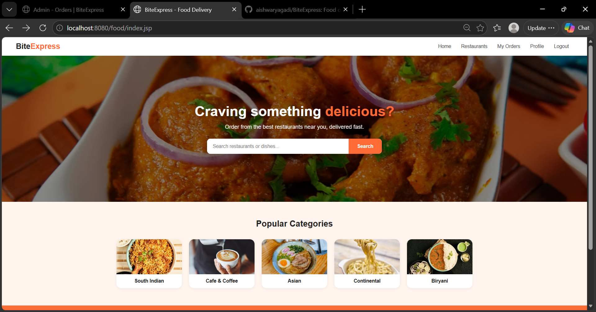
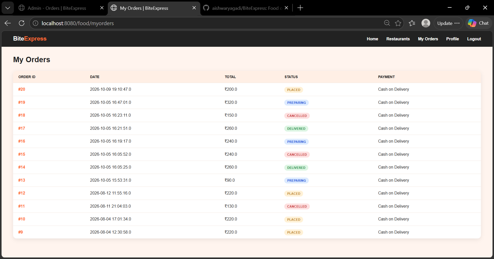
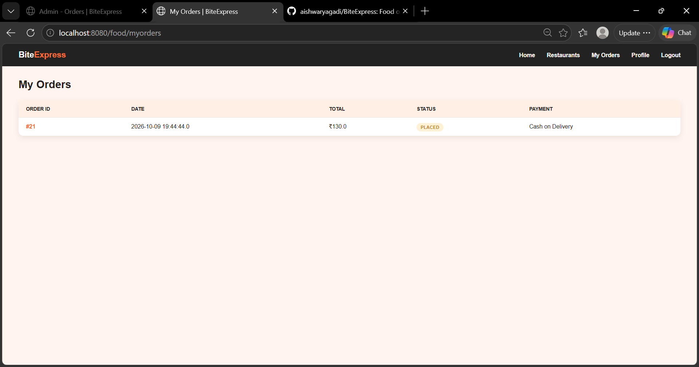

# BiteExpress

A food ordering web application built with Java Servlets, JSP and MySQL.

## Features

- Customer signup, login and logout, with passwords stored as BCrypt hashes
- Browse restaurants and their menus
- Shopping cart and checkout (Cash on Delivery)
- My Orders page showing each customer's own orders and their status
- Order details page showing the items in an order (customers can only open their own orders)
- Admin login and an admin page to view all orders and update their status
- Admin pages protected by a servlet filter

## Tech Stack

- Java (Servlets, JSP)
- Apache Tomcat 10
- MySQL
- JDBC
- BCrypt (password hashing)
- HTML and CSS

## How to Run

1. Install JDK, Eclipse IDE for Enterprise Java, Apache Tomcat 10 and MySQL.
2. In MySQL Workbench, create a database named `foodapp` and create the tables: `users`, `restaurant`, `menu`, `ordertable` and `orderitem`.
3. In the source folder, create a file named `db.properties` with your own settings:

```
db.url=jdbc:mysql://localhost:3306/foodapp
db.username=your-mysql-username
db.password=your-mysql-password
admin.username=your-admin-username
admin.password=your-admin-password
```

4. Import the project into Eclipse and add it to the Tomcat server.
5. Start Tomcat and open `http://localhost:8080/food/`.

`db.properties` is ignored by Git, so your passwords are never uploaded.

## Pages

| Page | URL |
|------|-----|
| Home | `/food/index.jsp` |
| Restaurants | `/food/restaurants` |
| My Orders | `/food/myorders` |
| Order Details | `/food/orderdetails?id=<order id>` |
| Admin Login | `/food/admin/login` |
| Admin Orders | `/food/admin/orders` |

## Screenshots





## Author

Aishwarya Gadi